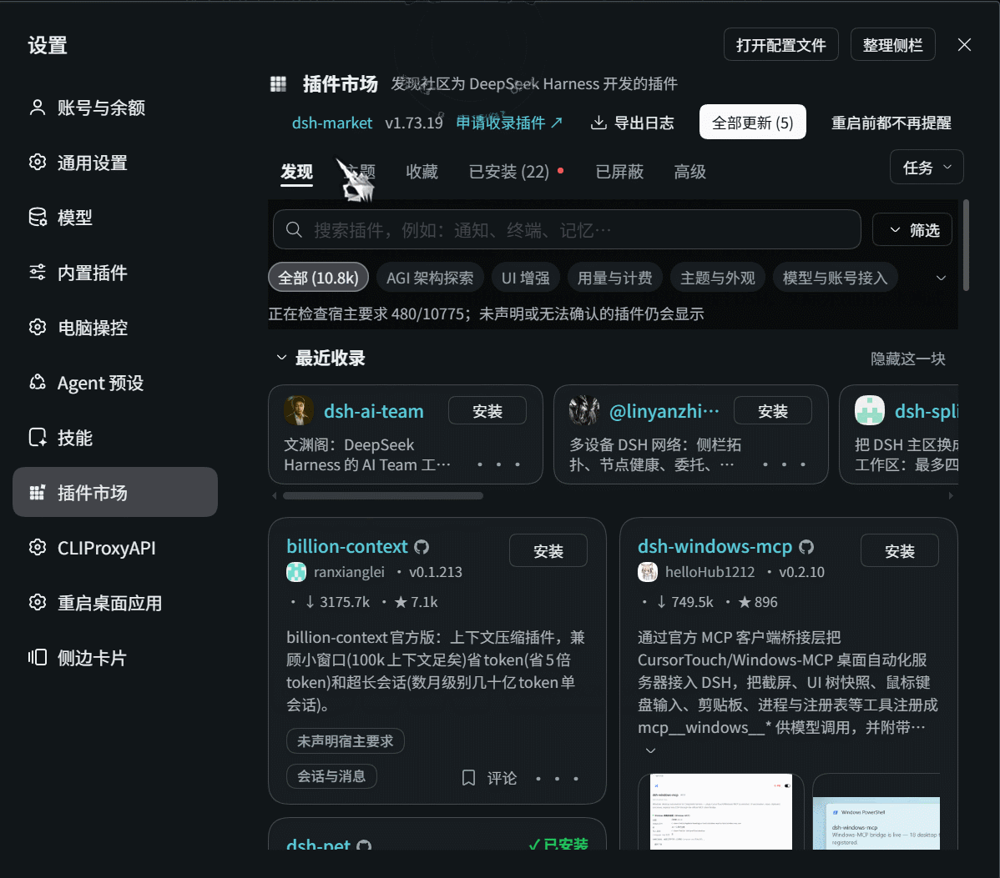

<div align="center">
  
  <h1>Settings Sidebar Organizer</h1>
  <p><strong>English</strong> · <a href="./README_zh.md">简体中文</a></p>
  <p>
    <a href="https://github.com/awesome-dsh-plugin/awesome-dsh-plugin"></a>
    <a href="https://github.com/deepseek-ai/deepseek-harness"></a>
    <a href="./LICENSE"></a>
  </p>
  <p>
    <a href="https://www.npmjs.com/package/dsh-settings-sidebar-organizer"></a>
    <a href="https://www.npmjs.com/package/dsh-settings-sidebar-organizer"></a>
    <a href="https://github.com/Six6stRINgs/dsh-settings-sidebar-organizer"></a>
    <a href="https://github.com/Six6stRINgs/dsh-settings-sidebar-organizer/"></a>
  </p>
</div>

**Organize DSH's settings sidebar with drag-and-drop.** Put frequently used pages first, collect related entries into named groups, and keep your layout between sessions.

- **Reorder entries:** drag to an edge or the gap between entries.
- **Create collapsible groups:** drop an entry in the center of another; move entries into, out of, or between groups.
- **Rename without crowding the sidebar:** use the group's **⋯** popup to rename or dissolve it.
- **Save your layout:** order, group membership, names, and expanded state are stored through DSH's settings.
- **Follow DSH's appearance:** theme-aware controls and Chinese/English UI that follows the application language.



## Installation

**Verified DSH version: `0.2.2-rc.1`.** Other versions have not been verified.

### npm (after publication)

Use the GitHub method until the first npm release is available.

For DSH Desktop's `desktop` profile:

```sh
dsh plugin --profile desktop add dsh-settings-sidebar-organizer
```

For the default CLI profile:

```sh
dsh plugin add dsh-settings-sidebar-organizer
```

### GitHub

For DSH Desktop's `desktop` profile:

```sh
dsh plugin --profile desktop add github:Six6stRINgs/dsh-settings-sidebar-organizer
```

For the default CLI profile:

```sh
dsh plugin add github:Six6stRINgs/dsh-settings-sidebar-organizer
```

If you use a different named profile, replace `desktop` with its name. These commands register the bundle with DSH; a plain `npm install` is not a substitute.

### DSH plugin page

1. Open **Plugins → Add plugin**.
2. After the npm release is available, enter the package name:

   ```text
   dsh-settings-sidebar-organizer
   ```

   Before the first release, or to install the development branch, use:

   ```text
   git+https://github.com/Six6stRINgs/dsh-settings-sidebar-organizer.git#main
   ```

3. Install and enable it, then open **Settings**. If the interface has not picked up the controls, refresh the window (`Ctrl+R`).

The repository includes its built runtime, so you do not need to build the source manually for normal installation.

## Usage

| Goal | Action |
| --- | --- |
| Reorder | Drop at an entry's edge or an insertion gap. |
| Create a group | Drop an entry in the center of another entry. |
| Add to a group | Drop onto a group or one of its children. |
| Expand or collapse | Click the group heading. |
| Rename | Click **⋯**, edit **Group name**, then choose **Save name** or press Enter. |
| Cancel editing | Choose **Cancel**, press Escape, or click outside the popup. Blur alone never saves. |
| Dissolve a group | Choose **Dissolve group** in **⋯**. Its entries return to the top level. |
| Move a child out | Right-click it and choose **Move to root**. |
| Reset | Open **Organize sidebar**, choose **Reset layout**, and confirm. |

Groups have two levels at most: a group can contain entries, not other groups. Keyboard alternatives are **Alt+Up/Down** to reorder and **Alt+Left** to move a child to the top level.

Changing DSH's language translates controls, not your group names or unsaved drafts. Read-only settings still allow opening pages and locally expanding groups, but cannot save layout changes.

## Compatibility and troubleshooting

- This plugin changes the settings navigation, not the application's main sidebar.
- If you previously installed an `@local/dsh-settings-sidebar-organizer` development bundle, disable that old bundle in DSH's plugin manager before enabling the public package. Do not enable both copies at once.
- Temporarily unavailable entries keep their saved membership. New entries appear automatically; a changed entry ID is treated as a new entry.
- Other plugins replacing the same settings component or intercepting global drag events may conflict.
- If **Organize sidebar** reports unsupported navigation or an attachment failure, native navigation is retained where possible. Include that status and your DSH version when [reporting a problem](https://github.com/Six6stRINgs/dsh-settings-sidebar-organizer/issues).

## How it works

A version-specific adapter decorates the existing settings component while keeping native pages and actions. Layout is recorded by stable entry IDs and saved through DSH's Host settings transport with revision checks, not by directly editing profile files. The group editor is rendered into the existing settings dialog, outside the sidebar's scroll area, so it does not move entries or get clipped by the sidebar.

## Development

```sh
git clone https://github.com/Six6stRINgs/dsh-settings-sidebar-organizer.git
cd dsh-settings-sidebar-organizer
npm install --ignore-scripts --no-package-lock
npm run check
```

```text
lib/      Installable Host entry and generated Client bundle
src/      Internal source modules and build script
test/     Automated tests
assets/   Showcase GIF
locale/   Plugin display translations
```

Run `npm run build` after source changes. Development dependencies are used only for testing and are not included in the distributed plugin. Automated tests do not replace visual testing in DSH.

## License

[MIT](https://github.com/Six6stRINgs/dsh-settings-sidebar-organizer/blob/main/LICENSE).
