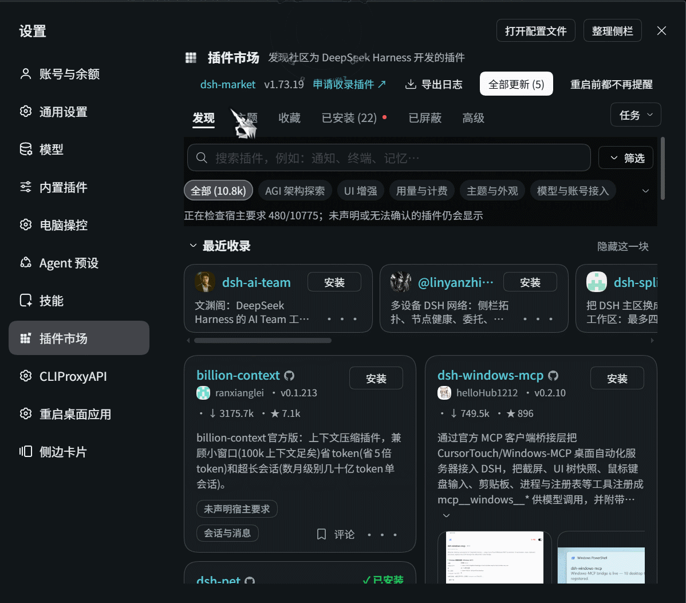

# dsh-settings-sidebar-organizer

[English](https://github.com/Six6stRINgs/dsh-settings-sidebar-organizer/blob/main/README.md) · **简体中文**

**用拖拽整理 DSH 设置侧栏。** 把常用页面放在前面，把相关入口收进自定义分组，并在下次使用时保留布局。

- **自由排序：** 拖到入口边缘或两个入口之间的间隙，即可调整顺序。
- **可折叠分组：** 放到另一个入口的正中心创建分组，也可将入口移入、移出或移到其他分组。
- **分组管理不挤侧栏：** 通过分组旁的 **⋯** 悬浮面板重命名或解散分组。
- **保存自己的布局：** 顺序、分组归属、名称和展开状态通过 DSH 设置保存。
- **跟随 DSH 外观：** 控件适配主题，中英文界面跟随应用语言设置。



## 安装

**已验证的 DSH 版本：`0.2.2-rc.1`。** 其他版本尚未验证。目前尚未发布到 npm，请使用下面任一种方式从 GitHub 安装。

### 命令行安装

DSH 桌面端使用 `desktop` profile：

```sh
dsh plugin --profile desktop add github:Six6stRINgs/dsh-settings-sidebar-organizer
```

使用命令行默认 profile：

```sh
dsh plugin add github:Six6stRINgs/dsh-settings-sidebar-organizer
```

如果你使用其他命名的 profile，将 `desktop` 换成实际名称。这些命令会将插件包注册到 DSH；单独执行普通的 `npm install` 不能替代插件安装。

### 在 DSH 插件页安装

1. 打开 **插件 → 添加插件**。
2. 填入 GitHub 包来源：

   ```text
   git+https://github.com/Six6stRINgs/dsh-settings-sidebar-organizer.git#main
   ```

3. 安装并启用后，打开 **设置**。如果界面尚未显示新增控件，刷新窗口（`Ctrl+R`）即可重新加载界面。

仓库已包含构建好的运行代码，正常安装不需要手动编译源码。

## 使用方法

| 你想做什么 | 操作 |
| --- | --- |
| 调整顺序 | 拖到入口边缘或插入间隙。 |
| 创建分组 | 将一个入口放到另一个入口的正中心。 |
| 加入分组 | 放到已有分组或它的子入口上。 |
| 展开或折叠 | 点击分组标题。 |
| 修改名称 | 点击 **⋯**，修改 **分组名称**，选择 **保存名称** 或按 Enter。 |
| 取消编辑 | 选择 **取消**、按 Escape，或点击浮层外部。输入框失去焦点不会自行保存。 |
| 解散分组 | 在 **⋯** 中选择 **解散分组**，组内入口会回到一级。 |
| 将子入口移出 | 右键点击它，选择 **移到一级**。 |
| 恢复默认 | 打开 **整理侧栏**，选择 **恢复默认布局** 并确认。 |

分组最多两层，只能包含入口，不能再包含分组。也可使用 **Alt+上/下方向键** 调整顺序，使用 **Alt+左方向键** 将子入口移到一级。

切换 DSH 语言只会翻译操作界面，不会改动分组名称或未保存的草稿。设置不可写时，仍可打开页面、临时展开分组，但不能保存布局变化。

## 兼容性与常见问题

- 插件整理的是设置导航，不是应用的主侧栏。
- 暂时不可用的入口保留原有分组归属，新入口会自动出现；入口 ID 改变则视为新入口。
- 替换同一个设置组件或拦截全局拖拽事件的其他插件，可能与本插件冲突。
- 如果 **整理侧栏** 提示导航结构不支持或接管失败，会尽可能保留原生导航。[反馈问题](https://github.com/Six6stRINgs/dsh-settings-sidebar-organizer/issues) 时，请附上状态提示和 DSH 版本。

## 简单原理

插件通过针对当前版本的适配层装饰已有设置组件，保留原生页面和操作。布局通过稳定的入口 ID 记录，再由 DSH Host 设置通道进行版本校验和保存，不会直接编辑用户的 profile 文件。分组编辑器渲染在原设置对话框内、侧栏滚动区域之外，因此不会挤动条目，也不会被侧栏裁切。

## 开发

```sh
git clone https://github.com/Six6stRINgs/dsh-settings-sidebar-organizer.git
cd dsh-settings-sidebar-organizer
npm install --ignore-scripts --no-package-lock
npm run check
```

```text
lib/      可安装的 Host 入口与构建好的 Client
src/      内部源码模块和构建脚本
test/     自动化测试
assets/   演示 GIF
locale/   插件展示信息的翻译
```

修改源码后运行 `npm run build`。开发依赖只用于测试，不随插件分发。自动测试不代替 DSH 内的实际视觉验收。

## 许可证

[MIT](https://github.com/Six6stRINgs/dsh-settings-sidebar-organizer/blob/main/LICENSE)。
